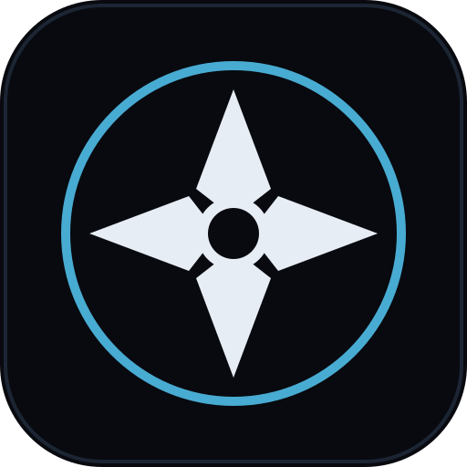
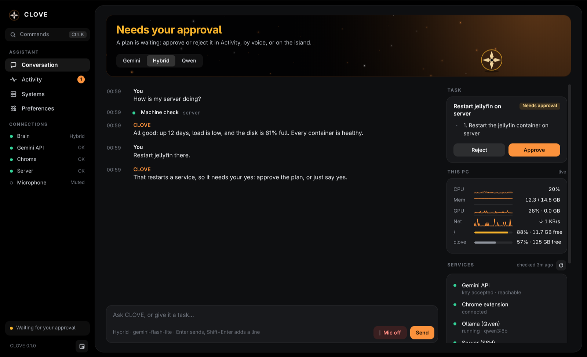

<div align="center">



# CLOVE

**A voice assistant for your Linux desktop that does the work itself, and asks before anything risky.**


</div>

Say "Clove" and ask. CLOVE opens apps, runs commands, checks your machines, reads your screen, uses the web
in your own Chrome, types what you dictate, and hands real coding work to a coding agent. Whatever could break
something (installing, deleting, restarting, using sudo, sending or buying on a website) waits for your yes.



<sub>Screenshots use demo data.</sub>

## What it does

- **Listens for its name.** Nothing goes to an AI until you say "Clove" (or turn the wake word off).
- **Answers out loud**, in a calm male or female voice, and shows the conversation in its window.
- **Does things on your PC**: opens apps and sites, changes volume, moves and closes windows, installs software
  with your package manager, runs commands, and tells you what happened.
- **Uses the web for you** in your own Chrome, with your logins: tabs, clicks, forms, WhatsApp Web.
- **Sees your screen** when you ask ("what's this error?"), and knows which project your terminal is in.
- **Looks after your machines**: health checks, logs and restarts on this PC and on servers you add over SSH.
- **Dictation**: speak, and it types into any app. Start a sentence with "Clove" to talk to it instead.
- **The CLOVE island**: a small bar at the top of the screen showing what CLOVE and your coding agents are doing,
  with Allow / Deny buttons for anything waiting for approval.
- **Asks first.** A plan with steps appears for anything risky, and nothing happens until you approve it by
  voice, in the window, or on the island. This is enforced by the program, not left to the AI.


## What you need

| | |
|---|---|
| **Computer** | Linux with a graphical desktop. Tested on Arch Linux (Omarchy) with Hyprland on Wayland. The assistant should work on other distributions; the island is tested on Hyprland only. |
| **Microphone and speakers** | Any; a headset works best. |
| **An AI brain** | A free Google Gemini API key ([get one here](https://aistudio.google.com/apikey)), or an NVIDIA GPU with 8 GB for the fully local brain. |
| **Chrome or Chromium** | For anything on the web. |
| **To build the island** | Rust and Node.js (the installer tells you if they're missing). |

## Install

1. Download CLOVE:
   ```bash
   git clone https://github.com/aryank2212/CLOVE.git
   cd CLOVE
   ```
2. Run the installer and answer its questions (your name, your Gemini key, whether to start CLOVE at login):
   ```bash
   ./install.sh
   ```
3. Start it, or just log in again:
   ```bash
   systemctl --user start clove
   ```
4. Say **"Clove, what can you do?"**

The installer can be run again at any time; it keeps your settings.

## Everyday use

| To | Do |
|---|---|
| Talk to CLOVE | Say "Clove", then your request. |
| Stop it speaking | Press Esc, or click the mark. |
| Open the CLOVE window | The app grid (**CLOVE**), or the island. |
| Approve or reject a plan | Say yes or no, or press Approve / Reject in the window or on the island. |
| Dictate into any app | Say "start dictation"; "stop dictation" ends it. |
| Fold or unfold the island | Ctrl+Alt+N |
| Open the command palette | Ctrl+K in the window |

Every setting is in the window under **Preferences**, and in the island under **General** and **Shortcuts**.

## Privacy

- **What leaves your PC**: with the Gemini or Hybrid brain, what you say after the wake word (as audio or
  text) goes to Google's Gemini API under your own key, with the title of the focused window and, for a terminal,
  its folder and git branch. Screenshots are sent only when you ask CLOVE to look at the screen.
  With the Qwen brain, everything stays on this PC.
- **Before the wake word**: listening for "Clove" happens on this PC. Nothing is sent before you say it.
- **Keys and passwords** stay in `assistant/.env` on your PC, readable only by you, and are never shown in
  the window.
- **Logs and memory** are kept in `~/.local/state/clove/` on your PC. There is no telemetry and no account.

## Remove CLOVE

```bash
assistant/scripts/install_autostart.sh --remove      # stop it starting at login
rm -f ~/.local/bin/clove-island ~/.local/bin/clove-island-hook ~/.config/autostart/CLOVE.desktop
rm -rf ~/.local/state/clove ~/.config/clove-island ~/.local/share/clove-island   # settings, logs, memory
```
Then delete the CLOVE folder. In Chrome, remove the **Clove & Rose Hands** extension.

## Licence

CLOVE is dual-licensed:

- **[AGPL-3.0](LICENSE)**: free to use, change and share, as long as anything you distribute or run as a
  service is released under the same licence, with its source code.
- **Commercial licence**: for products and services that can't follow the AGPL. See [COMMERCIAL.md](COMMERCIAL.md).

The island (`island/`) is a fork of [Coucou](https://github.com/Louis-CFM/coucou) by Louis Raillé and stays under
its [MIT licence](island/LICENSE). Coucou's name, character, icon and sounds belong to its author and are not part
of CLOVE, which uses its own. Third-party notices: [NOTICE.md](NOTICE.md).

## More

- [The full guide](docs/GUIDE.md): every feature, the three brains, calls, routines, and the code map.
- [Design](docs/DESIGN.md): the colours, type and shapes shared by every part of CLOVE.
- [The island](island/README.md): what it is and how to build it.
- [Security](SECURITY.md) · [Changes](CHANGELOG.md) · [Contributing](CONTRIBUTING.md)

**Status**: early access, 0.1.0. Tested on one setup (Arch Linux with Hyprland and an NVIDIA GPU). Please report
what doesn't work in [Issues](https://github.com/aryank2212/CLOVE/issues).
